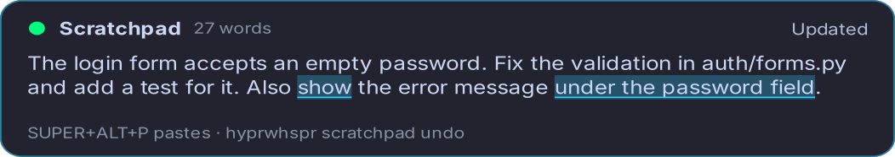

# Scratchpad

Build up text over several dictations, and paste it only when it's ready. Useful for anything you write in
passes, like a prompt for a coding agent: dictate a first version, add to it, correct parts of it, then paste the
finished text.

Each dictation into the scratchpad goes to the LLM you set up for [refinement](LLM_REFINEMENT.md), together with
the current draft. The LLM works out what you meant:

- **New content** is cleaned up like a refined dictation and added: "the parser crashes on empty input, find out
  why" goes at the end of the draft
- **An instruction about the draft** changes it: "change Postgres to SQLite", "drop the last sentence", "in the
  second point, mention the timeout", "make it shorter", "turn that into a list", "start over"
- Requests meant for whoever reads the draft stay content. "Add tests for the parser" is part of your prompt,
  not an instruction to the LLM. Only a dictation about the draft itself edits it

Nothing is pasted while you draft. A [preview panel](#preview-panel) shows the draft as it grows, with the last
change highlighted.

## Setup

The scratchpad uses the provider, key and model from `hyprwhspr config llm` (see
[LLM refinement](LLM_REFINEMENT.md#setup)). `llm_refine_enabled` can stay off: your other dictations then paste
unrefined, while scratchpad dictations still go to the LLM.

Add a key to draft and a key to paste:

```jsonc
{
    "scratchpad_shortcut": "SUPER+ALT+S",        // records like primary_shortcut, into the draft
    "scratchpad_paste_shortcut": "SUPER+ALT+P"   // pastes the draft when you release it
}
```

Restart the service afterwards:

```bash
systemctl --user restart hyprwhspr
```

The scratchpad key follows `recording_mode`: held in push-to-talk, tapped in toggle. In long-form mode, it
starts a session that goes into the draft on submit. In continuous mode, each segment is applied to the draft as
it comes in.

With [compositor bindings](HOTKEYS.md#scratchpad-keys) (`external_bindings`), both settings are ignored; bind the
commands below instead.

## Drafting a prompt

1. Press the scratchpad key and say: "the login form accepts an empty password, fix the validation and add a
   test for it"
2. Press it again: "also make sure the error message is translated". This is added to the draft
3. Again: "actually not translated, I meant shown under the field". The draft is corrected
4. Focus the agent's text field and press the paste key

The draft is pasted as it is, line breaks included. It's never followed by an Enter, even with `auto_submit` on,
so you can read it over in the target before you send it. After a paste the draft is cleared, ready for the next
one. `hyprwhspr scratchpad undo` brings it back.

## Preview panel

While you dictate into the scratchpad, a panel above the recording overlay shows the draft:



- The header follows the dictation: listening, transcribing, updating the draft, then the result. Paused shows
  while a long-form session is paused
- After each change the words that changed are highlighted and scrolled into view. A deletion scrolls to where
  the text was removed
- The panel stays up for `scratchpad_preview_seconds` (8) after a change, then hides. Set it to `0` to keep the
  panel on screen until you paste or clear the draft
- A paste, copy or clear shows briefly. `scratchpad undo` shows the restored draft like any other change
- The panel never takes keyboard focus, and clicks go through it, so the field you'll paste into keeps focus
- It uses the [mic OSD theme](FEEDBACK.md), including Omarchy and Noctalia colors

The panel needs GTK4 and gtk4-layer-shell, the same as the [mic OSD](FEEDBACK.md), and a compositor with layer
shell support (Hyprland, Sway, niri, river and others). It runs as a small separate process that starts the first
time you use the scratchpad and quits after ten minutes hidden. On GNOME, or with `"scratchpad_preview": false`,
each change shows in a desktop notification instead.

## Commands

```bash
hyprwhspr record toggle --scratchpad   # record a dictation into the draft (or record start --scratchpad)
hyprwhspr scratchpad                   # print the draft (same as: scratchpad show)
hyprwhspr scratchpad paste             # paste it into the focused app
hyprwhspr scratchpad copy              # copy it to the clipboard
hyprwhspr scratchpad undo              # undo the last change: an edit, a paste's clear, or a clear
hyprwhspr scratchpad clear             # start a new draft
hyprwhspr scratchpad edit              # open the draft in $EDITOR
hyprwhspr scratchpad status            # size, keys and model
```

- **Typing and talking mix.** The draft is re-read before every change, so you can fix a word in
  `scratchpad edit` and keep dictating. If you save in the editor while the LLM is working on a dictation, your
  edit wins: the dictation isn't applied, and you can recover it with `hyprwhspr record copy-last`
- **Undo** keeps the last 20 changes made by dictations, clears and pastes. It doesn't record edits made in
  `$EDITOR`, and it's reset when the service restarts
- **Paste from a binding.** Run `scratchpad paste` from a hotkey, so the target app keeps focus. Run from a
  terminal, it pastes into that terminal
- `hyprwhspr scratchpad show | wl-copy` and other pipes get only the draft

Try the scratchpad prompt against your current draft, without changing it:

```bash
hyprwhspr config llm test --scratchpad "make the first sentence shorter"
```

## Where the draft is kept

The draft is one file, `$XDG_RUNTIME_DIR/hyprwhspr/scratchpad.md`, readable only by you (mode `0600`). The
runtime directory is in memory: the draft survives a service restart, and is gone after you log out or reboot.
The service log never contains it. While the panel shows the draft, a copy sits next to it in
`scratchpad_preview.json`, also `0600`; it's removed when the service stops.

## Configuration

```jsonc
{
    "scratchpad_shortcut": null,          // e.g. "SUPER+ALT+S"
    "scratchpad_paste_shortcut": null,    // e.g. "SUPER+ALT+P"
    "scratchpad_model": null,             // null = llm_refine_model
    "scratchpad_timeout": 30,             // seconds per edit
    "scratchpad_clear_on_paste": true,    // false keeps the draft after a paste
    "scratchpad_preview": true,           // the preview panel; false = notifications
    "scratchpad_preview_seconds": 8       // panel time after a change; 0 = until paste or clear
}
```

The LLM rewrites the whole draft on every dictation, so a long draft takes longer than a single refinement. That
is why the timeout defaults to 30 seconds rather than 15. Fast models without extended reasoning still work best;
use `scratchpad_model` to give the scratchpad a stronger model than your refinement model.
`llm_refine_extra_instructions` (names, spelling) also apply to the scratchpad. `llm_refine_prompt` and the
refinement prompt file don't.

## Failures

If an edit fails (no key, network error, timeout, or a reply without a complete draft), the draft is left
unchanged. The panel and a notification show the reason, and the dictation is kept for
`hyprwhspr record copy-last`. Nothing is ever pasted by mistake, and a dictation that was meant as an edit
is never added to the draft word for word.

[Word overrides, filler filtering and symbol replacements](TEXT_PROCESSING.md) apply to each dictation before it
goes to the LLM.

Not available for scratchpad recordings:

- [Live typing](../backends/REALTIME_WEBSOCKET.md), because the edit needs the whole dictation
- `post_transcription_hook` and [translation](LLM_REFINEMENT.md#translation). The hook doesn't run on the draft
  when it's pasted either
